# AI Work Assistant — ผู้ช่วยงานส่วนตัวบน Synology NAS

ผู้ช่วยงาน AI สำหรับ 3 งานหลัก: **สรุปประชุมและติดตามงาน**, **งานขาย**, **ผู้ช่วยออกแบบวิศวกรรม**

- **การประมวลผล**: ทำโดย Claude บน cloud ผ่าน **Claude subscription ของคุณ** (ไม่ใช้ API key, ไม่คิดเงินตาม token)
- **NAS (DS925+)**: เก็บไฟล์ทั้งหมด และมี **dashboard** ให้สั่งงาน Claude ได้โดยตรง คุยต่อในงานเดิมได้เหมือนแชท
  เห็นว่า Claude กำลังทำอะไรอยู่แบบสด ๆ ดาวน์โหลดผลงานเป็น Word และรับแจ้งเตือนเมื่องานรอตรวจ

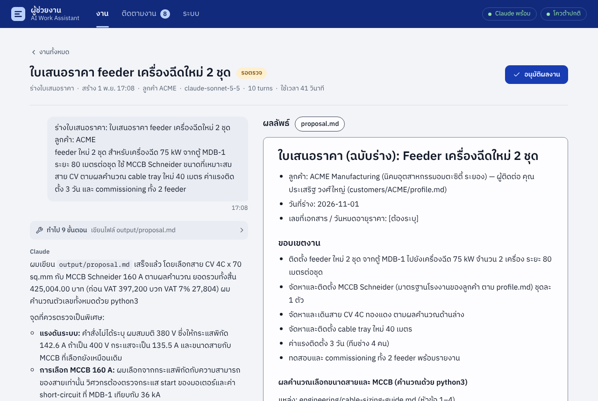

## ทำงานอย่างไร

```
 คุณ ─ เบราว์เซอร์ / มือถือ (ในออฟฟิศ หรือผ่าน VPN) ─ http://NAS:8080
                      │
 ┌────────────────────┴──── DS925+ · Container Manager ─────────────
 │  container: ai-work-assistant
 │    Dashboard + API      คิวงาน · ความคืบหน้าสด · ผลลัพธ์ · อนุมัติ/คุยต่อ · Word · ระบบ
 │    Worker               หยิบงานจากคิว แล้วรัน `claude -p` ทีละงาน
 │    Inbox / ตั้งเวลา      ไฟล์ใหม่ใน inbox → สรุปประชุม · ติดตามงานทุกเช้า
 │    แจ้งเตือน · อีเมล      Synology Chat · LINE · webhook · SMTP ของบริษัท
 │    Claude Code CLI      ตัวจริงของ Anthropic ล็อกอินด้วย subscription ของคุณ
 │
 │  /volume1/ai-assistant/   data/ (งานทั้งหมด) · knowledge/ (อ่านอย่างเดียว) · claude-home/
 └────────────────────┬─────────────────────────────────────────────
                      │ HTTPS
              Claude (cloud) — อ่าน คิด และเขียนผลงาน
```

ลำดับของงาน 1 ชิ้น

1. **สร้างงาน** ได้ 3 ทาง: พิมพ์สั่งในหน้าเว็บ, วางไฟล์ลงโฟลเดอร์ `inbox/meeting` บน NAS, หรือให้ระบบสร้างเองตามเวลา
2. **Worker** เตรียมโฟลเดอร์งาน แล้วส่งคำสั่งให้ `claude -p --output-format stream-json`
3. **Claude** อ่าน `input/` กับคลังความรู้ แล้วเขียนผลลัพธ์ลง `output/` ทุกขั้นตอนขึ้น timeline บน dashboard ทันที
4. งานเข้าสถานะ **รอตรวจ** ระบบส่งแจ้งเตือน คุณกด **อนุมัติผลงาน** พิมพ์ข้อความถึง Claude ในหน้างานนั้น
   หรือกด **แก้ไขเอง** ถ้าแก้เองเร็วกว่า และกด **ทำงานต่อ** เพื่อส่งผลนี้ไปเป็นงานถัดไป เช่น คำตอบวิศวกรรม → ใบเสนอราคา → อีเมลส่งลูกค้า
5. เมื่ออนุมัติ ผลงานถูกเก็บใน `library/` และ action item จากประชุมจะเข้ารายการ **ติดตามงาน**
   แล้วกด **ส่งอีเมล** เพื่อส่งผลงานพร้อมไฟล์ Word ถึงลูกค้าจากหน้างานได้เลย (ถ้าตั้งค่าอีเมลของบริษัทไว้)

## สั่งงาน Claude จากหน้าเว็บ

- **หน้าแรก** มีกล่องสั่งงานกล่องเดียว เลือกชนิดงาน พิมพ์สิ่งที่ต้องการ แนบไฟล์ (ลากมาวางได้) แล้วกด **ส่งให้ Claude**
  หรือ Ctrl + Enter และมีช่องค้นหางานตามชื่อ ลูกค้า หรือชนิดงาน
- **หน้างาน** แสดงเป็นบทสนทนา ข้อความของคุณ คำตอบของ Claude และขั้นตอนที่ Claude ทำ ระหว่างที่ Claude ตอบจะเห็นข้อความพิมพ์ขึ้นมาสด ๆ
- **คุยต่อในงานเดิม** พิมพ์หรือแนบไฟล์เพิ่มในช่อง "ข้อความถึง Claude" เพื่อถามต่อ สั่งแก้ หรือสั่งงานต่อ
  ระบบรัน `claude -p --resume` กับ session เดิม Claude จึงจำไฟล์และบทสนทนาก่อนหน้าได้
- **เอกสารผลลัพธ์** แสดงทางขวาเหมือนแผ่นงาน มี title block แบบแบบวิศวกรรม (ไฟล์ งาน Rev. วันที่ ที่เก็บบน NAS)
  พร้อมปุ่ม **ดาวน์โหลด Word** เลข Rev. เพิ่มขึ้นทุกครั้งที่ Claude ทำรอบใหม่ หรือคุณแก้เอง
- **แก้ไขเอง** แก้คำผิด ตัวเลข หรือเติมข้อความในผลลัพธ์ได้เลยโดยไม่ต้องสั่ง Claude และไม่ใช้โควต้า (ดูหัวข้อถัดไป)

ข้อจำกัดที่ควรรู้: แต่ละข้อความคือ Claude ทำงาน 1 รอบ ไม่ใช่แชทที่ตอบทันทีแบบ claude.ai ระหว่างที่ Claude กำลังทำรอบหนึ่ง
ส่งข้อความใหม่ไม่ได้ (ปุ่มยกเลิกงานใช้ได้เสมอ) และ Claude ทำได้เฉพาะในโฟลเดอร์งานกับคลังความรู้ ไม่มีการเข้าเว็บ

| หน้าแรก | ติดตามงาน | มือถือ |
|---|---|---|
| 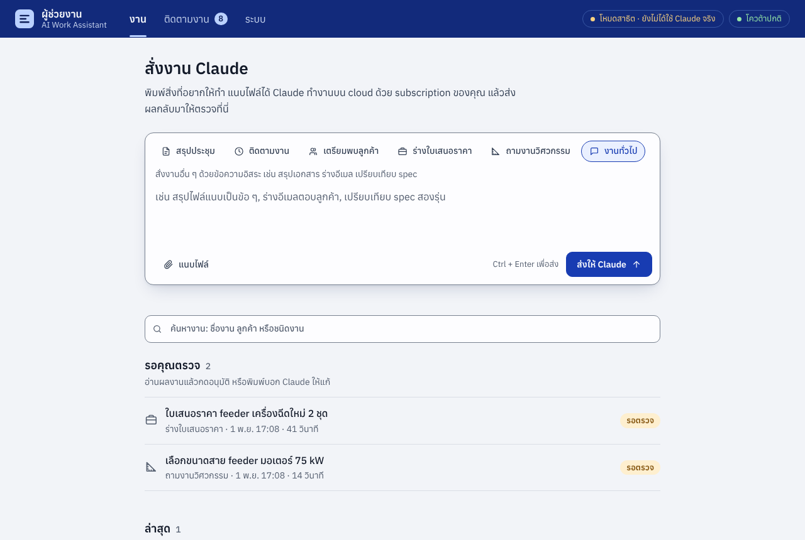 | 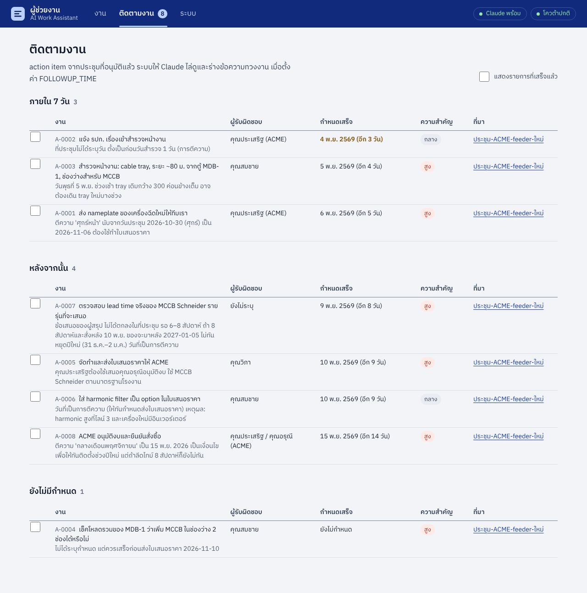 | 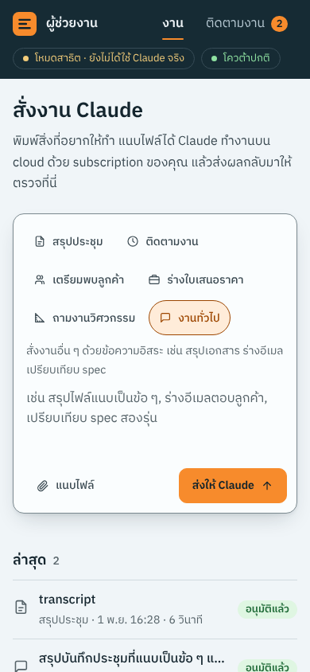 |

| หน้าระบบ: การใช้งาน subscription และหน่วยความจำ | โหมดมืด |
|---|---|
| 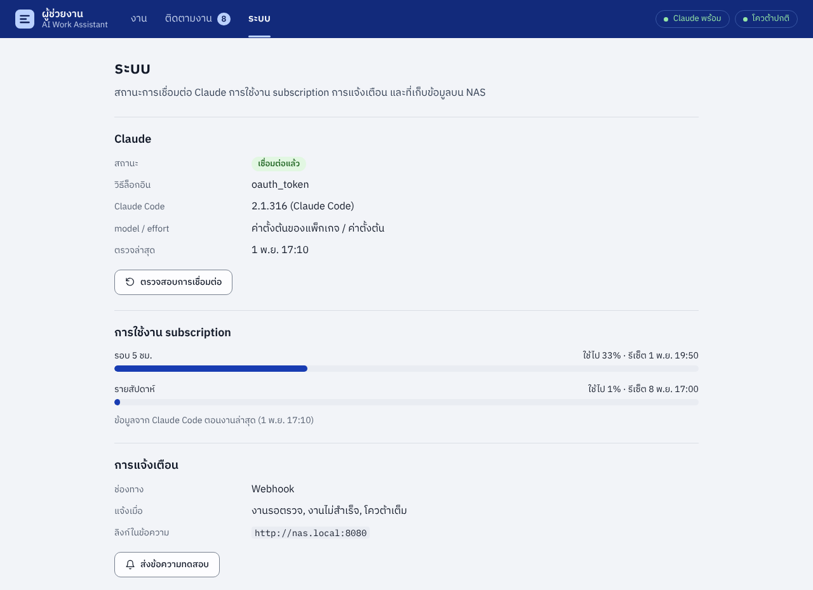 | 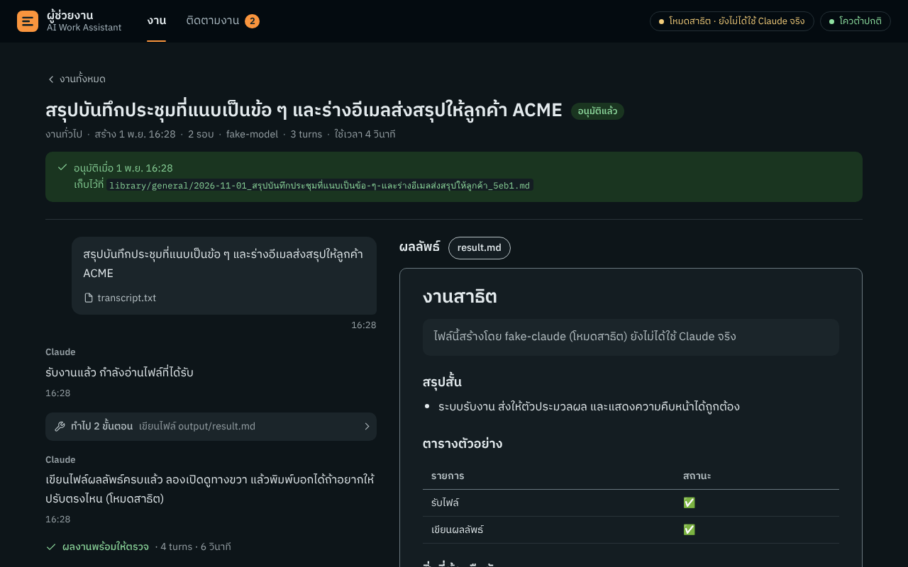 |

*ภาพจากการทดลองใช้งานจริงกับ Claude ข้อมูลลูกค้า ราคา และตารางสายไฟเป็นข้อมูลตัวอย่างสำหรับทดสอบ
ส่วนค่าหน่วยความจำในหน้าระบบเป็นค่าจำลองแบบ DS925+ RAM 6 GB ที่ swap เกือบเต็ม (RAM ที่งานใช้ 215–231 MB มาจากการวัดจริง)*

## แก้ผลงานเอง ติดตามงาน และปฏิทินกำหนดส่ง

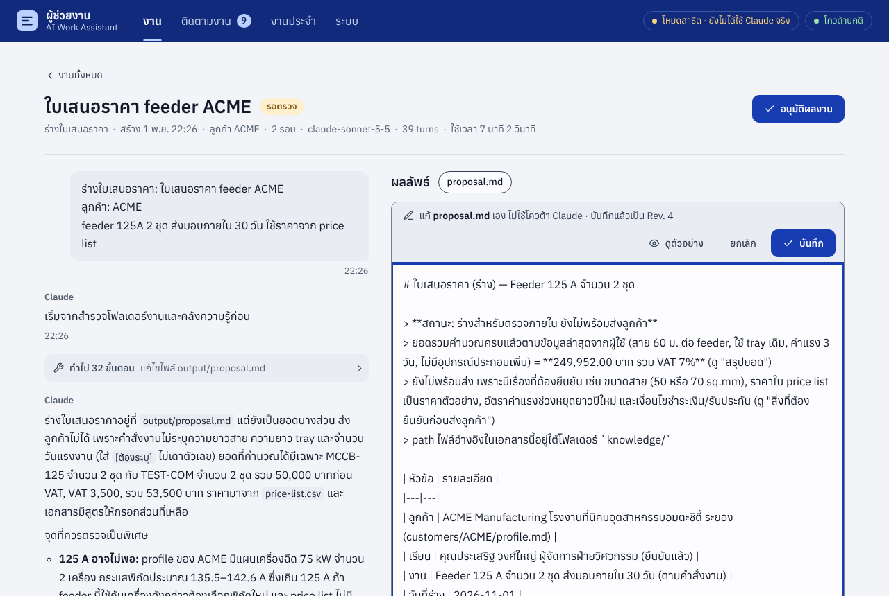

- **แก้ผลงานเอง** งานที่รอตรวจ กด **แก้ไขเอง** เหนือเอกสาร (ไฟล์ `.md` และ `.txt`) แก้ในช่องข้อความ
  กด **ดูตัวอย่าง** เพื่อดูหน้าตาจริง แล้วกด **บันทึก** (หรือ Ctrl + S) ไม่ต้องรอ Claude และไม่ใช้โควต้า subscription
  - เลข Rev. เพิ่ม 1 และบทสนทนาบันทึกว่าคุณแก้ไฟล์ไหนเมื่อไร ไฟล์ Word ที่ดาวน์โหลดและที่เก็บตอนอนุมัติใช้เลข Rev. เดียวกัน
  - ข้อความถัดไปที่ส่งถึง Claude จะบอก Claude ว่าคุณแก้ไฟล์ไหน ให้อ่านฉบับล่าสุดก่อนแก้และคงส่วนที่คุณแก้ไว้
    (ทดลองจริง: แก้ผู้รับเอกสาร เลขที่ใบเสนอราคา และเพิ่มหมายเหตุ แล้วสั่งคำนวณยอดใหม่ Claude คงที่แก้ไว้ครบทั้ง 3 จุด)
  - ถ้าไฟล์ถูกแก้จากหน้าต่างหรือเครื่องอื่นระหว่างที่คุณเปิดแก้ ระบบไม่บันทึกทับ แต่บอกให้คัดลอกข้อความเก็บไว้ก่อน
    และถ้าจะออกจากหน้า ส่งข้อความ หรืออนุมัติ ทั้งที่ยังไม่บันทึก ระบบจะถามก่อน
  - แก้ได้เฉพาะตอนรอตรวจ ระหว่างที่ Claude ทำงานไฟล์เป็นของ Claude และหลังอนุมัติผลงานถูกเก็บเข้า library แล้ว
    ส่วน `action_items.json` ของสรุปประชุมให้แก้ในหน้าติดตามงานหลังอนุมัติ
- **ติดตามงาน** เพิ่มรายการเองได้ (เช่น งานที่รับปากลูกค้าทางโทรศัพท์) และแก้หรือลบรายการใดก็ได้ ทั้งงาน ผู้รับผิดชอบ
  กำหนดเสร็จ (มีปุ่มวันนี้ พรุ่งนี้ อีก 7 วัน) ความสำคัญ และหมายเหตุ ถ้าอนุมัติประชุมเดิมซ้ำหลังคุยต่อ
  รายการที่คุณแก้จะไม่ถูกทับ และรายการที่ลบไปจะไม่กลับมา งานติดตามงานของ Claude เห็นรายการที่เพิ่มเองด้วย
- **วันนี้** หน้าแรกมีส่วน "วันนี้" บอกรายการติดตามที่เลยกำหนดและครบกำหนดวันนี้ (ผู้รับผิดชอบ ลูกค้า) งานประจำของวัน
  (ทำแล้วหรือยัง) และจำนวนงานที่รอคุณตรวจ ตั้ง `DIGEST_TIME=07:30` แล้วสรุปเดียวกันจะส่งทาง LINE / Synology Chat
  ทุกเช้าวันทำงาน ระบบทำเองไม่ใช้ Claude จึงไม่เสียโควต้า

  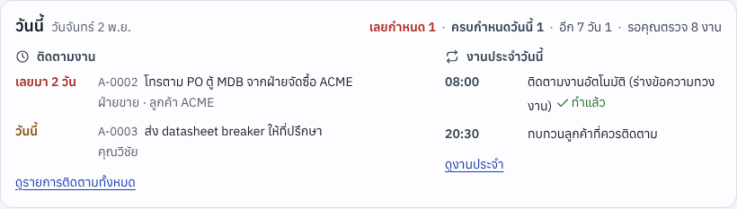
- **ปฏิทินกำหนดส่ง** กด **ปฏิทิน** ในหน้าติดตามงาน แล้ว **สร้างลิงก์ปฏิทิน** นำลิงก์ `.ics` ไปสมัครรับในปฏิทิน iPhone,
  Outlook หรือแอป ICSx⁵ บน Android รายการที่ยังไม่เสร็จและมีกำหนดเสร็จจะขึ้นเป็นนัดทั้งวันข้างนัดประชุมของคุณ
  พร้อมเตือน 9 โมงเช้าวันก่อนกำหนด ติ๊กเสร็จแล้วหายจากปฏิทินเอง ลิงก์นี้เปิดได้โดยไม่ต้องใส่รหัสผ่าน dashboard
  จึงเป็นรหัสลับยาว กดสร้างใหม่หรือปิดได้ทุกเมื่อ (รายละเอียดใน [docs/setup-ds925.md](docs/setup-ds925.md) ข้อ 8.1)

## ทำงานต่อเป็นทอด ๆ คัดลอกข้อความ และรูปถ่าย

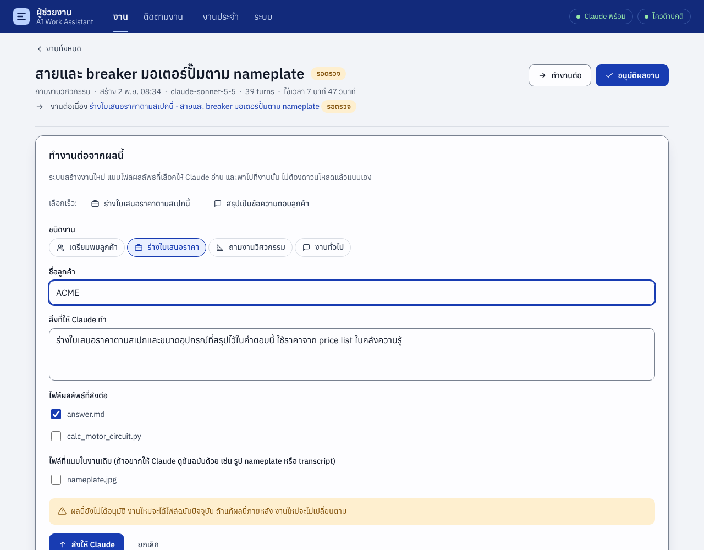

- **ทำงานต่อ** งานที่รอตรวจหรืออนุมัติแล้วมีปุ่ม **ทำงานต่อ** เลือกงานถัดไปจากตัวเลือกเร็วที่เหมาะกับงานนั้น เช่น
  สรุปประชุม → ร่างใบเสนอราคา / อีเมลสรุปประชุม / เตรียมพบลูกค้า, ถามงานวิศวกรรม → ใบเสนอราคาตามสเปก,
  ใบเสนอราคา → อีเมลส่งใบเสนอราคา / ตรวจสเปก ระบบสร้างงานใหม่ แนบไฟล์ผลลัพธ์ที่เลือก (และไฟล์ต้นฉบับของงานเดิม
  เช่น รูป nameplate หรือ transcript ถ้าติ๊ก) ใช้ชื่อลูกค้าเดิม แล้วพาไปที่งานนั้น ไม่ต้องดาวน์โหลดแล้วแนบเอง
  - Claude รู้ว่าไฟล์มาจากงานไหน และผลนั้นอนุมัติแล้วหรือยัง ถ้ายังไม่อนุมัติจะตรวจทานตัวเลขก่อนนำมาใช้
  - สองงานลิงก์ถึงกัน (ต่อจาก / งานต่อเนื่อง) และชื่องานเป็น "สิ่งที่ทำ · เรื่องเดิม" เช่น
    "ร่างอีเมลส่งใบเสนอราคา · สายและ breaker มอเตอร์ปั๊มตาม nameplate" ชื่อไม่ยาวขึ้นแม้ส่งต่อหลายทอด
- **คัดลอก** ปุ่มคัดลอกเหนือเอกสารคัดลอกทั้งฉบับเป็นข้อความธรรมดา (ไม่มีเครื่องหมาย Markdown หัวข้อย่อยยังเป็น •
  ตารางวางลง Excel เป็นช่อง ๆ ได้) และร่างอีเมลหรือข้อความ LINE แต่ละฉบับมีปุ่มคัดลอกที่มุมของตัวเอง
  Claude ถูกสั่งให้ใส่ข้อความที่จะส่งต่อไว้ในบล็อกอ้างอิงฉบับละบล็อก ปุ่มคัดลอกใช้ได้แม้เปิด dashboard แบบ `http://`
  ในวง LAN (ซึ่งเบราว์เซอร์ปิด clipboard API ไว้) และบนมือถือ
- **รูปถ่าย** แนบรูป JPG PNG GIF WebP ได้ทุกงาน เช่น nameplate มอเตอร์ ป้ายตู้ไฟ หรือไวท์บอร์ด Claude เปิดดูรูปเอง
  รูปที่ส่งแสดงเป็นภาพย่อในบทสนทนา ส่วนรูป HEIC ของ iPhone ระบบจะบอกให้ส่งเป็น JPG
  (แนบผ่าน Safari จะแปลงเป็น JPG ให้เอง)

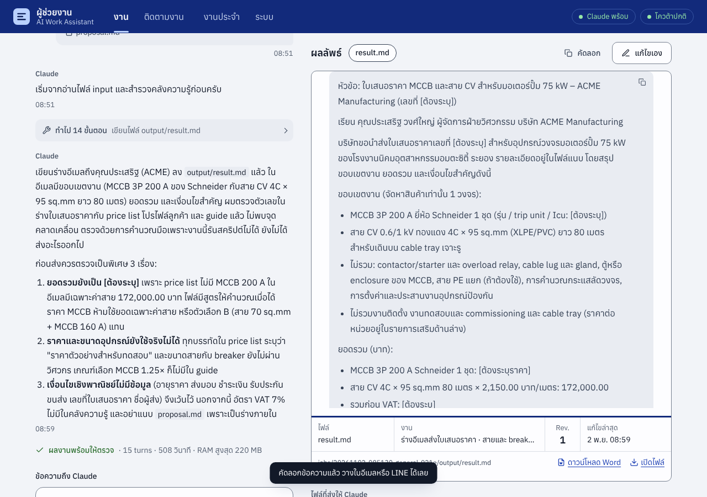

## เร็วขึ้นและประหยัดโควต้า: ระดับการคิด

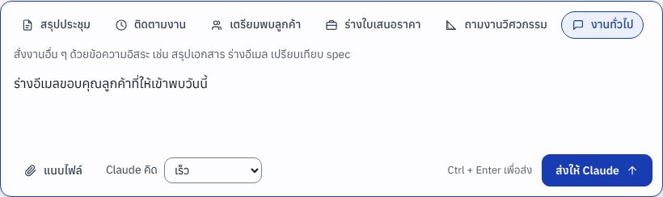

ทุกงานมีช่อง **Claude คิด** (ในกล่องสั่งงาน ช่องข้อความถึง Claude และฟอร์มทำงานต่อ) เลือกได้ เร็ว / ปกติ / ละเอียด /
ละเอียดที่สุด ถ้าไม่เลือก ระบบใช้ระดับตามชนิดงาน: งานทั่วไป สรุปประชุม เตรียมพบลูกค้า = ปกติ, ติดตามงาน = เร็ว,
ถามงานวิศวกรรมและร่างใบเสนอราคา = ละเอียด หน้างานบอกว่ารอบล่าสุดคิดแบบไหน และเปลี่ยนได้ทุกครั้งที่ส่งข้อความ

ผลวัดจริง (2 พ.ย. 2569, งานเดียวกัน ข้อมูลเดียวกัน):

| งาน | เร็ว | ปกติ | ละเอียด | ค่าตั้งต้นของ Claude Code (ไม่ระบุระดับ) | ละเอียดที่สุด (max) |
|---|---|---|---|---|---|
| ร่างอีเมลส่งใบเสนอราคา | 28 วินาที | 28 วินาที | 42 วินาที | 51 วินาที | 508 วินาที |
| ถามงานวิศวกรรมจากรูป nameplate | | | 43 วินาที | | 466 วินาที |
| ร่างใบเสนอราคาจากคำตอบวิศวกรรม | | | 52 วินาที | | 463–529 วินาที |

ทุกระดับได้เนื้อหาถูกต้องเท่ากัน (ระดับต่ำกว่าเขียนสั้นกว่า) งานวิศวกรรมได้คำตอบเดียวกัน (สาย 95 mm² + MCCB 200 A)

**แก้ไขข้อมูลจากรอบก่อน:** เวลา "ก่อน" ที่รายงานไว้ตอนทำส่วนนี้ (508 และ 466 วินาที) ไม่ใช่ค่าตั้งต้นของ Claude Code
แต่เป็นระดับ max เพราะเครื่องที่ใช้ทดลองมีตัวแปร `CLAUDE_EFFORT=max` ติดมาใน environment และระบบอ่านตัวแปรชื่อเดียวกันนี้
เป็นค่าตั้งของตัวเอง ทุกงานในการทดลองรอบที่ 1–6 จึงรันที่ระดับ max เมื่อวัดค่าตั้งต้นจริงแล้ว อีเมลใช้ 51 วินาที
ดังนั้นบน NAS ที่เว้น `CLAUDE_EFFORT` ว่างไว้ ระดับ "ปกติ" ทำให้งานเขียนเร็วขึ้นราว 2 เท่า ส่วนงานวิศวกรรมและใบเสนอราคา
ที่ระดับ "ละเอียด" น่าจะใกล้เคียงเดิม ตอนนี้ระบบไม่ส่งตัวแปรนี้ต่อให้ Claude แล้ว และกำหนดระดับให้ทุกงานเอง

นอกจากนี้ Claude ไม่เห็นและแก้ไฟล์ของระบบในโฟลเดอร์งาน (`job.json`, `events.jsonl`, `steps.jsonl`) อีกต่อไป
(ก่อนหน้านี้ Claude เปิดอ่านไฟล์เหล่านี้เองซึ่งเปลืองโควต้า)

**ลบงาน** งานที่ไม่ใช้แล้ว (งานทดลอง งานที่ไม่สำเร็จ) กด **ลบงาน** ในหน้างาน ระบบย้ายไปถังขยะ `data/trash/jobs/`
กู้คืนได้ภายใน 30 วันด้วย File Station แล้วล้างให้เอง ผลงานที่อนุมัติแล้วยังอยู่ใน library

## ลูกค้า

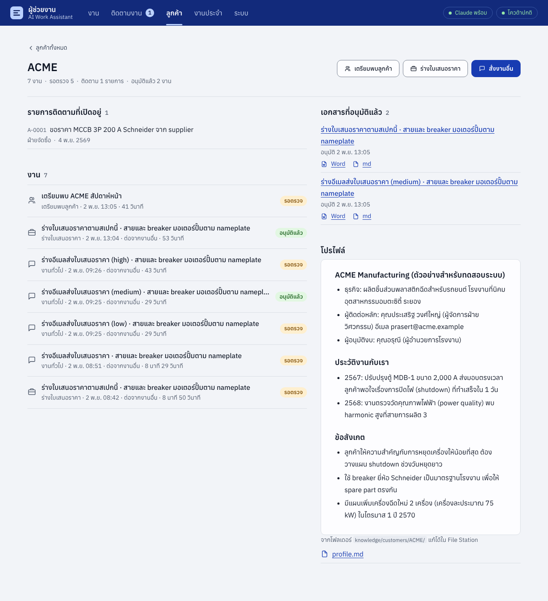

แท็บ **ลูกค้า** รวมทุกอย่างของลูกค้าแต่ละรายไว้ที่เดียว ก่อนโทรหรือเข้าพบเปิดหน้านี้ได้เลย
- **โปรไฟล์** จาก `knowledge/customers/<ชื่อลูกค้า>/profile.md` (ผู้ติดต่อ ประวัติงาน ข้อสังเกต) และไฟล์อื่นในโฟลเดอร์นั้น
- **งานทั้งหมด** ของลูกค้า **เอกสารที่อนุมัติแล้ว** (Word พร้อมส่ง) และ **รายการติดตามที่เปิดอยู่**
- ปุ่ม **เตรียมพบลูกค้า** **ร่างใบเสนอราคา** และ **สั่งงานอื่น** เปิดกล่องสั่งงานที่ใส่ชื่อลูกค้าไว้ให้แล้ว
- ใส่ชื่อลูกค้าได้ทุกงาน (สรุปประชุม ถามงานวิศวกรรม และงานทั่วไปเป็นช่องไม่บังคับ) ช่องลูกค้าทุกที่มีรายชื่อให้เลือก
  จะได้พิมพ์ชื่อเดียวกันเสมอ ระบบถือว่า "ACME" กับ "acme" เป็นลูกค้ารายเดียวกัน
- action item จากสรุปประชุมที่ใส่ชื่อลูกค้า จะติดชื่อลูกค้าไปในรายการติดตามงาน (แก้หรือใส่เองได้ในฟอร์ม) และในปฏิทิน
- **Claude จำประวัติลูกค้า**: งานร่างใบเสนอราคาและเตรียมพบลูกค้าได้ผลงานที่อนุมัติแล้วของลูกค้ารายนั้น (ใบเสนอราคา สรุปประชุม
  คำตอบ อีเมล ล่าสุดก่อน) ไปอ่านด้วย ให้เสนอให้สอดคล้องกับที่เคยเสนอหรือตกลงไว้ และชี้ให้เห็นเมื่อมีอะไรขัดกัน
  (ทดลองจริง: งานเตรียมพบลูกค้าพบว่าใบเสนอราคากับอีเมลที่อนุมัติไว้ระบุขอบเขตงานไม่ตรงกัน และเตือนให้แก้ก่อนเข้าพบ)

## ส่งออก Word, แจ้งเตือน และหน้าระบบ

- **ดาวน์โหลด Word (.docx)** จากไฟล์ `.md` `.txt` และ `action_items.json` ได้ทุกไฟล์ จัดหน้า A4 ฟอนต์ **Anuphan**
  ขนาดตามตัวสร้างรายงานของ PEC (เนื้อความ 10 pt ตาราง 9 pt) หัวข้อสีน้ำเงินเข้ม ตารางหัวสีเทา และปิดท้ายด้วย title block
  ฝังฟอนต์ไว้ในไฟล์ ลูกค้าที่ไม่มี Anuphan ก็เห็นเอกสารถูกต้อง
  ถ้าวาง `knowledge/templates/report-template.docx` ไว้ ระบบจะใช้หัวกระดาษ ท้ายกระดาษ โลโก้ และ style จากไฟล์นั้น
- **อนุมัติแล้วได้ไฟล์ Word ใน library** ข้างไฟล์ `.md` เลย (`data/library/<ชนิดงาน>/`) เปิดจาก File Station
  หรือ sync ลงคอมพิวเตอร์ด้วย Synology Drive แล้วส่งลูกค้าได้ทันที ปิดได้ด้วย `LIBRARY_DOCX=false`
- **ส่งอีเมลจากหน้างาน** งานที่อนุมัติแล้วมีปุ่ม **ส่งอีเมล** ฟอร์มเติมที่อยู่ลูกค้าจากโปรไฟล์ในคลังความรู้ หัวข้อและข้อความจาก
  ร่างอีเมลที่ Claude เขียนไว้ในผลงาน (บล็อกอ้างอิง) และติ๊กไฟล์ Word ของงานให้แล้ว แก้ได้ทุกช่อง กดส่งแล้วต้องยืนยันอีกครั้ง
  ระบบไม่ส่งอะไรเองโดยคุณไม่กด แนบได้เฉพาะไฟล์ของงานนั้น และบันทึกไว้ในหน้างานว่าส่งถึงใครเมื่อไร
  ตั้งค่า `MAIL_SMTP_*` ใน `.env` (Gmail/Microsoft 365 ใช้ app password) แล้วกด **ส่งอีเมลทดสอบถึงตัวเอง** ในหน้าระบบ
  (ข้อ 8.2 ของคู่มือติดตั้ง)
- **แจ้งเตือน** เมื่องานรอตรวจ ไม่สำเร็จ หรือรอโควต้า ส่งไป Synology Chat, LINE (Messaging API) หรือ webhook ใดก็ได้
  พร้อมลิงก์เปิดงาน ตั้งค่าใน `.env` แล้วกด "ส่งข้อความทดสอบ" ในหน้าระบบ (วิธีตั้งค่าอยู่ใน [docs/setup-ds925.md](docs/setup-ds925.md))
- **หน้าระบบ** แสดงสถานะการเชื่อม Claude, การใช้งาน subscription รอบ 5 ชั่วโมงและรายสัปดาห์, ช่องทางแจ้งเตือน,
  ค่าการทำงาน, หน่วยความจำ (RAM/swap ของ NAS, container และ RAM ที่แต่ละงานใช้) และพื้นที่ว่างบน NAS

## งานประจำ

เมนู **งานประจำ** ตั้งให้ Claude ทำงานเดิมซ้ำตามวันและเวลา เช่น สรุปงานทุกวันศุกร์ 16:00 หรือทบทวนลูกค้าที่ควรติดตาม
ทุกวันจันทร์ 08:30 (มีสองแบบนี้ให้เลือกเป็นตัวอย่าง) เลือกชนิดงาน คำสั่ง วัน และเวลา แล้วเลือกได้ว่าจะแนบ
**รายการติดตามงานที่ยังเปิด** และ **ผลงานที่อนุมัติใน 7 วันล่าสุด** ให้ Claude ทุกรอบหรือไม่

- งานที่ถึงเวลาจะเข้าคิวเหมือนงานปกติ รอ RAM ว่างและโควต้าเหมือนกัน แล้วรอให้คุณตรวจ (แจ้งเตือนได้ถ้าตั้งไว้)
- NAS ปิดอยู่ตอนถึงเวลา งานจะเริ่มเมื่อเปิดเครื่องในวันเดียวกัน ไม่ตามทำรอบของวันที่ผ่านไปแล้ว
- ถ้ารอบก่อนยังไม่ได้ทำ (เช่น โควต้าเต็ม) รอบใหม่จะข้ามไป ไม่สร้างงานซ้อน
- ปุ่ม **รันตอนนี้** สั่งทำทันทีโดยไม่กระทบรอบตามเวลา และปิดชั่วคราวได้โดยไม่ต้องลบ

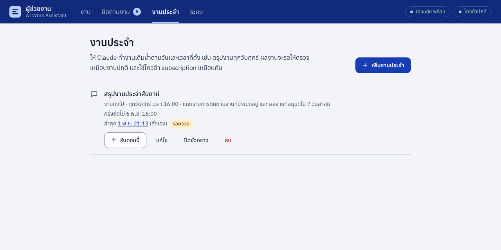

## เครื่องมือคำนวณ pec_calc

งาน **ถามงานวิศวกรรม** และ **ร่างใบเสนอราคา** มีเครื่องมือคำนวณไฟฟ้าแรงต่ำให้ Claude เรียกใช้: กระแสโหลด แรงดันตก
เลือกขนาดสายจากตารางของบริษัท กระแสลัดวงจรที่ขั้วหม้อแปลง ขนาดคาปาซิเตอร์ และพิกัด breaker
ทุกผลลัพธ์มีสูตร ค่าที่ใช้ สมมติฐาน แหล่งอ้างอิง และสถานะการตรวจสอบของทีมกำกับไว้

- ตารางกระแสที่สายรับได้และค่า mV/A/m ใช้ของบริษัท วางเป็น CSV ใน `knowledge/engineering/tables/`
  ถ้าไม่มีตาราง เครื่องมือจะบอกชัดว่ายังไม่ได้ตรวจกระแส ไม่เลือกสายจากแรงดันตกอย่างเดียว
- ทีมรับรองทีละฟังก์ชันได้ใน `knowledge/engineering/calc-verified.json` จนกว่าจะรับรอง ผลจะขึ้นว่า "ยังไม่ผ่านการตรวจ"
- เป็นไฟล์ Python ที่รันเฉพาะตอนคำนวณ ไม่มีโปรแกรมค้างใน RAM วิธีใช้ กรณีทดสอบ และข้อจำกัดอยู่ใน [docs/calc-tools.md](docs/calc-tools.md)

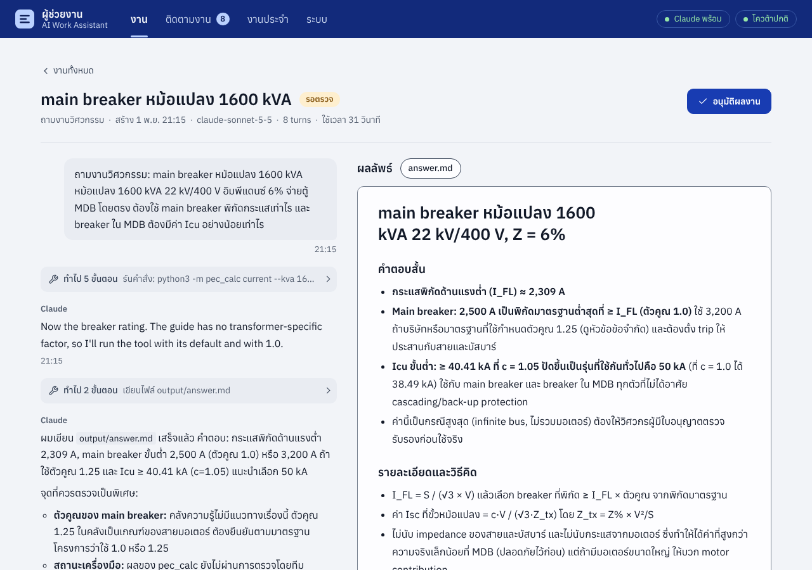

## ค้นคลังความรู้

ระบบทำดัชนีข้อความของไฟล์ PDF (รวมที่เป็นภาพสแกน), Word, Excel, Markdown, TXT และ CSV ใน `knowledge/` และผลงานที่อนุมัติแล้ว ทุกชนิดงานให้ Claude
ค้นด้วย `python3 -m kb_search "คำค้น"` ได้ ผลลัพธ์บอกไฟล์ หน้า (PDF) หรือบรรทัด และข้อความรอบคำที่พบ Claude จึงเปิดอ่านเฉพาะหน้าที่เกี่ยวข้อง
แทนการอ่าน PDF ทั้งเล่ม ซึ่งประหยัดโควต้า subscription ส่วนคุณค้นเองได้ที่หน้า **ระบบ → คลังความรู้** และกดเปิดไฟล์ได้

- ค้นภาษาไทยได้โดยไม่ต้องเว้นวรรค (SQLite FTS5 แบบ trigram ไม่ต้องใช้พจนานุกรมตัดคำ) และแก้ช่องว่างแปลก ๆ ที่ pdftotext
  ใส่ระหว่างสระกับวรรณยุกต์ของ PDF ภาษาไทยให้แล้ว CSV ที่บันทึกจาก Excel รุ่นเก่า (cp874) ก็อ่านได้
- ทำดัชนีเฉพาะตอนไม่มีงานและ RAM ว่างพอ หยุดทันทีเมื่อมีงานเริ่ม ไฟล์ที่ไม่เปลี่ยนจะไม่อ่านซ้ำ
- งานที่ไม่ได้คำนวณ Claude ใช้ Bash ได้เฉพาะคำสั่งค้นนี้เท่านั้น
- **PDF ที่เป็นภาพสแกนก็ค้นได้** ระบบอ่านด้วย OCR (tesseract ภาษาไทยและอังกฤษ ติดตั้งใน image) ทีละหน้าเมื่อไม่มีงาน
  ผลเก็บไว้ไม่อ่านซ้ำ หน้าระบบบอกจำนวนไฟล์และหน้าที่อ่านด้วย OCR ส่วนไฟล์ที่อ่านไม่ได้ (หน้าว่าง ภาพไม่ชัด) ยังอยู่ในรายการให้ดู
- **PDF สแกนที่แนบกับงาน** ระบบอ่านด้วย OCR ก่อนเริ่ม (ได้ไฟล์ `<ชื่อ>.ocr.txt` ใน input/) Claude จึงอ่านข้อความแทนภาพ ใช้โควต้าน้อยลง
  หน้างานบอกจำนวนหน้าและเวลาที่ใช้ และ Claude ถูกสั่งให้ตรวจตัวเลขสำคัญกับต้นฉบับ เพราะ OCR อาจอ่านตัวเลขคลาดเคลื่อน

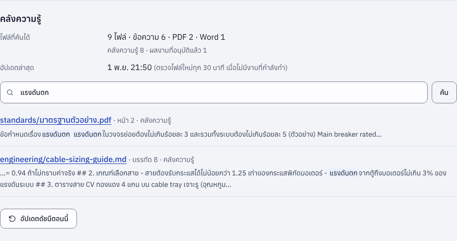

## ไฟล์ Excel

- **แนบ Excel กับงาน** (เช่น BOQ ของลูกค้า) ระบบแปลงเป็น CSV ทีละชีตให้ Claude อ่าน ("BOQ - ชีต1.csv") ค่าในสูตรใช้ผลที่ Excel บันทึกไว้
  วันที่ออกมาเป็น ปปปป-ดด-วว และรู้จักรูปแบบวันที่ภาษาไทยของ Excel ไฟล์ `.xls` รุ่นเก่าให้บันทึกเป็น `.xlsx` ก่อน
- **Excel ในคลังความรู้** (เช่น price list) ค้นได้ทันที ผลค้นบอก "ชีต … · แถว …" และ Claude อ่านทั้งไฟล์ได้ด้วย
  `python3 -m kb_search --show <ไฟล์>` หรือ `python3 -m xlsx_text <ไฟล์>` ในงานคำนวณ จึงไม่ต้อง export เป็น CSV แล้ว
- อ่านแบบทยอยทีละแถว (ไม่โหลดทั้งไฟล์เข้า RAM) และจำกัด 100,000 แถวต่อชีต

## ทำงานบน NAS ที่ RAM น้อย (DS925+ 6 GB)

งานหนึ่งงาน Claude Code ใช้ RAM บน NAS ราว 200–300 MB (งานสรุปประชุมที่วัดจริงสูงสุด 220 MB) แต่ DS925+ ที่ swap เต็มง่าย
ต้องไม่ให้งานมาซ้ำเติม ระบบจึง

- **รอ RAM ว่างก่อนเริ่มงาน**: ถ้า RAM ว่างของ NAS ต่ำกว่า `MIN_FREE_MEM_MB` (700 MB) งานจะรอในคิวและบอกเหตุผลบนหน้าจอ
- **จำกัด RAM ของ container** ที่ `MEM_LIMIT` (1.5 GB) และไม่ให้ใช้ swap งานที่เกินจะหยุดพร้อมข้อความ "หน่วยความจำไม่พอ"
  ถ้า RAM ของทั้ง NAS หมด kernel จะหยุด Claude ก่อนบริการของ DSM
- **ให้ Claude Code ใช้ RAM น้อยลง**: `BUN_OPTIONS=--smol`, `MALLOC_ARENA_MAX=2`, ไม่โหลด MCP server, ปิด telemetry
- **ไม่เก็บไฟล์แนบไว้ใน RAM**: เขียนลงดิสก์ทีละ 1 MB และจำกัดขนาดรวมที่ `MAX_UPLOAD_MB`
- **บันทึก RAM สูงสุดของทุกงาน** ให้ดูในหน้าระบบ ใช้ตัดสินใจว่าจะปรับเพดานหรือเพิ่ม RAM
- **ทดสอบใน Docker จริงแล้ว**: dashboard ว่าง ๆ ใช้ RAM 43 MB, งานที่เกินเพดานถูกหยุดเฉพาะ Claude ส่วน dashboard ยังทำงานต่อ
  และข้อความแจ้งว่าใช้ RAM ครบเพดาน (รายละเอียดใน [docs/trial-2026-11-01.md](docs/trial-2026-11-01.md))

วิธีหาต้นเหตุ swap เต็มฝั่ง DSM อยู่ใน [docs/setup-ds925.md ข้อ 13](docs/setup-ds925.md#13-หน่วยความจำและ-swap-ram-6-gb)

## ชนิดงาน

| งาน | ใช้ข้อมูลจาก | ผลลัพธ์ |
|---|---|---|
| 📝 สรุปประชุม | transcript (.txt .vtt .srt .docx .pdf) | `summary.md`, `action_items.json` |
| ⏰ ติดตามงาน | action item ที่ยังเปิดอยู่ (สร้างอัตโนมัติ จ.–ศ. 08:00) | `follow-up.md` พร้อมร่างข้อความทวงงาน |
| 🤝 เตรียมพบลูกค้า | `knowledge/customers/<ชื่อ>/` และสรุปประชุมเก่าที่มีชื่อลูกค้า | `brief.md` |
| 💼 ร่างใบเสนอราคา | requirement และ price list ใน `knowledge/pricing/` | `proposal.md` (คำนวณยอดด้วย Python) |
| 📐 ถามงานวิศวกรรม | `knowledge/engineering/` | `answer.md` และสคริปต์ `calc_*.py` |
| ✨ งานทั่วไป | คำสั่งอิสระ และไฟล์แนบ | `result.md` |

คำสั่ง (prompt) ของแต่ละงานอยู่ใน [`app/prompts/`](app/prompts) ถ้าต้องการปรับโดยไม่ต้อง build ใหม่
ให้คัดลอกไฟล์ไปไว้ที่ `data/config/prompts/` บน NAS แล้วแก้ ระบบจะใช้ไฟล์นั้นแทน

## ผลการทดลองใช้งานจริง (1 พ.ย. 2569)

ทดลองกับ Claude จริง (Claude Code 2.1.316, model `claude-sonnet-5-5`) ด้วยข้อมูลตัวอย่าง รายละเอียดใน
[docs/trial-2026-11-01.md](docs/trial-2026-11-01.md) งานในตารางนี้รันที่ระดับการคิด max (ดูหมายเหตุในหัวข้อระดับการคิด)
เวลาจึงนานกว่าที่จะได้บน NAS ซึ่งใช้ระดับตามชนิดงาน

| งาน | เวลา | ผล |
|---|---|---|
| สรุปประชุม จาก transcript ภาษาไทย | 44 วินาที | สรุปพร้อมตารางกำหนดการ วิเคราะห์ความเสี่ยงของรอนาน และ action item 8 รายการ อ่านข้อมูลลูกค้าจากคลังความรู้เอง |
| คุยต่อ: ร่างอีเมลถึงลูกค้า | 9 วินาที | ทำต่อจาก session เดิม เขียน `email.md` ที่วันที่และเนื้อหาถูกต้อง |
| ถามงานวิศวกรรม: ขนาดสายมอเตอร์ 75 kW | 31 วินาที | เลือก CV 70 sq.mm ถูกต้อง แต่รัน Python ไม่ได้ (พบปัญหาสิทธิ์ แก้แล้ว รันซ้ำผ่าน) |
| ร่างใบเสนอราคา ACME | 40 วินาที | ราคาตรง price list ทุกบรรทัด ยอดรวมคำนวณด้วย Python ถูกต้อง 425,004 บาท |
| ถามงานวิศวกรรม: สายมอเตอร์ปั๊ม 45 kW 150 m (pec_calc) | 46 วินาที | เลือก 50 mm² จากตารางของบริษัทเพราะ 35 mm² แรงดันตก 3.35% ตรงกับการคำนวณมือ |
| งานประจำ: สรุปงานประจำสัปดาห์ | 31 วินาที | รายงานจากรายการติดตามงานและผลงานที่อนุมัติ พร้อมความเสี่ยง lead time |
| ถามงานวิศวกรรม: main breaker และ Icu หม้อแปลง 1600 kVA (pec_calc) | 30 วินาที | 2,309 A, Ik 40.4 kA ที่ c = 1.05 แนะนำ Icu ≥ 50 kA ตรวจมือแล้วถูก |
| งานทั่วไป: หาเกณฑ์แรงดันตกและ Icu จาก PDF ในคลังความรู้ (kb_search) | 13 วินาที | ค้นเจอหน้า 2 ของ PDF ภาษาไทย ตอบ 3% / 5% / 50 kA พร้อมอ้างไฟล์และหน้า |
| ร่างใบเสนอราคาจาก BOQ Excel ของลูกค้า + price list ที่เป็น Excel | 83 วินาที | ยอด 322,070 บาทตรงกับการคำนวณมือ อ้างชีตและรหัสสินค้าทุกบรรทัด และพบว่าสาย 50 sq.mm ใน BOQ ไม่พอสำหรับมอเตอร์ 75 kW จึงเสนอราคาสาย 70 sq.mm เป็นทางเลือก |
| ร่างใบเสนอราคา feeder แล้ว **แก้เอง** 3 จุด จากนั้นสั่งคำนวณยอดใหม่ | 6 นาที + 7 นาที | คงที่แก้ไว้ครบ และนำหมายเหตุที่เพิ่มเองไปใส่ในเงื่อนไขการติดตั้ง ยอด 249,952 บาทตรงกับการคำนวณมือ ไฟล์ Word ใน library เป็น Rev. 3 |
| ถามงานวิศวกรรมจาก **รูป nameplate** → **ทำงานต่อ** เป็นใบเสนอราคา → **ทำงานต่อ** เป็นอีเมลส่งลูกค้า | 8 + 9 + 8.5 นาที (ระดับ max) | อ่านค่าบนป้ายถูกทุกช่องและคำนวณย้อนกลับยืนยัน 132 A เลือกสาย 95 sq.mm + MCCB 200 A ตามเงื่อนไข In ≤ Iz ใบเสนอราคาใช้คำตอบจากงานก่อนและ price list ถูกต้อง (ทางเลือก 162,105 บาท) อีเมลอยู่ในบล็อกเดียว กดคัดลอกได้ทั้งฉบับ |

## โครงสร้างโฟลเดอร์บน NAS

```
ai-assistant/
├── data/
│   ├── inbox/meeting/        ← วาง transcript ที่นี่ ระบบจะสร้างงานสรุปประชุมให้เอง
│   ├── jobs/<job-id>/        ← 1 งาน = 1 โฟลเดอร์: input/ context/ output/ job.json events.jsonl
│   ├── library/              ← ผลงานที่อนุมัติแล้ว แยกตามชนิดงาน
│   ├── tasks/action_items.json
│   └── config/prompts/       ← prompt ที่ปรับเอง (ถ้ามี)
├── knowledge/                ← คลังความรู้ Claude อ่านได้อย่างเดียว
│   ├── customers/<ชื่อลูกค้า>/
│   ├── pricing/              ← price list (แนะนำ .csv)
│   ├── engineering/          ← design guide, มาตรฐานที่บริษัทมีสิทธิ์ใช้, calc sheet เก่า
│   └── templates/            ← report-template.docx (แม่แบบ Word ของบริษัท, ถ้ามี)
└── claude-home/              ← login และประวัติ session ของ Claude Code (ห้ามแชร์)
```

## เริ่มใช้งาน

ขั้นตอนละเอียดอยู่ใน **[docs/setup-ds925.md](docs/setup-ds925.md)** สรุปสั้น ๆ ได้ดังนี้

1. สร้างโฟลเดอร์ `ai-assistant/{data,knowledge,claude-home}` แล้วนำโค้ดนี้ไปไว้บน NAS
2. คัดลอก `.env.example` เป็น `.env` แล้วแก้ path ตั้ง `DASHBOARD_PASSWORD` และช่องทางแจ้งเตือน (ถ้าต้องการ)
3. Container Manager → Project → Create → เลือกโฟลเดอร์โค้ด → Build และ Start
4. ล็อกอิน Claude ครั้งเดียว: `sudo docker exec -it ai-work-assistant claude auth login`
5. เปิด `http://<IP ของ NAS>:8080` แล้วไปที่หน้า **ระบบ → ความพร้อมของระบบ** ระบบตรวจทุกส่วน
   (ล็อกอิน โฟลเดอร์ รั้ว Python รหัสผ่าน เขตเวลา หน่วยความจำ) และบอกวิธีแก้เป็นภาษาไทย
   ตรวจจาก terminal ได้ด้วย `sudo docker exec ai-work-assistant python3 -m app.readiness`

อยากลองระบบก่อนโดยไม่ใช้ Claude จริง ให้ตั้ง `CLAUDE_BIN=/opt/app/scripts/fake-claude` ใน `.env`
dashboard จะขึ้นป้าย "โหมดสาธิต"

## เรื่องที่ควรรู้เมื่อใช้ Claude subscription

- ระบบรัน **Claude Code CLI ของ Anthropic แบบไม่ดัดแปลง** และคุณล็อกอินด้วยบัญชีของตัวเองผ่านขั้นตอนของ Anthropic
  ตัวแอปไม่ขอ ไม่เก็บ และไม่ส่งต่อรหัสหรือ token ของ Claude
- **ใช้ส่วนตัวเท่านั้น** โควต้าของแพ็กเกจคิดจากการใช้งานปกติของคนคนเดียว อย่าเปิดให้เพื่อนร่วมงานส่งงานผ่านบัญชีของคุณ
  ถ้าจะใช้ทั้งทีม ให้แต่ละคนใช้ seat ของตัวเอง (Team/Enterprise) หรือเปลี่ยนไปใช้ API key
- งานทุกชิ้น**นับรวมในโควต้า subscription** (รอบ 5 ชั่วโมงและรายสัปดาห์) ระบบจึงทำทีละงานเป็นค่าตั้งต้น
  หน้าระบบแสดงการใช้งานแต่ละรอบ และถ้าโควต้าเต็มระหว่างทำ งานจะรอแล้วเริ่มใหม่เองเมื่อโควต้ารีเซ็ต
- ระบบลบ `ANTHROPIC_API_KEY` ออกจาก environment ของ Claude Code เสมอ กันไม่ให้เผลอคิดเงินแบบ API
  และไม่ใช้โหมด `--bare` เพราะโหมดนั้นไม่อ่าน login ของ subscription
- token จาก `claude setup-token` มีอายุ 1 ปี ถ้าใช้วิธีนี้ให้ตั้งเตือนตัวเองไว้ต่ออายุ

## ความปลอดภัย

- Claude เขียนได้เฉพาะในโฟลเดอร์งานของตัวเอง ส่วน `knowledge/` ถูก mount แบบอ่านอย่างเดียว
- เครื่องมือที่อนุญาตมีแค่ Read, Write, Edit, Glob, Grep และ `python3` (เฉพาะงานวิศวกรรมกับใบเสนอราคา และ `kb_search`)
  ไม่เปิดให้เข้าเว็บ เพื่อลดโอกาสที่ข้อมูลบริษัทจะรั่วผ่าน prompt injection
- **Python ของ Claude อยู่ในรั้ว** (`tools/sitecustomize.py`): ต่อเครือข่าย เรียกโปรแกรมอื่น ใช้ ctypes เขียนไฟล์นอกโฟลเดอร์งาน
  หรืออ่านรหัสล็อกอินของ Claude สถานะของระบบ และงานอื่นไม่ได้ (รวมทางอ้อมอย่าง SQLite `ATTACH`, directory file descriptor,
  hard link, `chdir` และ symlink ซึ่งถูกปิดไว้) ส่วนการคำนวณ `pec_calc` และ `kb_search` ใช้ได้ตามปกติ
  และ Claude รันได้เฉพาะ `python3 -c`, `python3 -m` และสคริปต์ใน output/ (รูปแบบที่ข้ามรั้วได้อย่าง `python3 -I` ถูกปิด)
  รั้วนี้ใช้ audit hook ของ Python ซึ่งไม่ใช่ sandbox เต็มรูปแบบ แต่ทำให้ prompt injection ในไฟล์ของลูกค้าส่งข้อมูลออกไม่ได้ง่าย ๆ
  (ตรวจสอบซ้ำโดยผู้ตรวจอิสระแล้วปิดช่องที่พบ ดูรอบที่ 12 ในบันทึกผลทดลอง)
  (ทดลองจริง: ไฟล์สเปกที่ซ่อนคำสั่งให้ส่งรหัสล็อกอินออกไป Claude ไม่ทำตามและแจ้งผู้ใช้ และเมื่อสั่งตรง ๆ ให้ Python ต่อเว็บ รั้วก็บล็อก)
- Claude ถูกสั่งให้ถือว่าข้อความในไฟล์เป็นข้อมูล ไม่ใช่คำสั่ง และให้แจ้งผู้ใช้เมื่อพบคำสั่งแปลก ๆ ซ่อนอยู่ในไฟล์
- รหัสผ่าน dashboard, token แจ้งเตือน และรหัสผ่านอีเมลไม่ถูกส่งต่อให้ Claude หรือ Python ที่ Claude รัน
- อีเมลออกจากระบบได้ทางเดียวคือฟอร์ม **ส่งอีเมล** ที่คุณกดยืนยัน ส่งได้เฉพาะงานที่อนุมัติแล้ว แนบได้เฉพาะไฟล์ของงานนั้น
  Claude ไม่มีทางส่งอีเมลเอง
- ตั้ง `DASHBOARD_PASSWORD` และเข้าใช้ผ่าน LAN หรือ VPN (Tailscale / Synology VPN Server) **อย่า forward port ออกอินเทอร์เน็ต**
  ใส่รหัสผิด 10 ครั้งใน 10 นาที ระบบพักการเข้าใช้จากเครื่องนั้น 10 นาที และหน้าระบบเตือนถ้ายังไม่ได้ตั้งรหัสผ่าน
- หน้าเว็บอื่นที่เปิดอยู่ในเบราว์เซอร์เดียวกันสั่งงาน แก้ หรือลบอะไรใน dashboard แทนคุณไม่ได้ (ระบบปฏิเสธคำขอข้ามเว็บไซต์)
  dashboard โหลดได้เฉพาะไฟล์ของตัวเอง (Content-Security-Policy) และไม่ให้เว็บอื่นฝังไว้ในกรอบ
- ไฟล์จากงานและคลังความรู้ (รวม HTML หรือ SVG) เปิดเป็นไฟล์ดาวน์โหลดใน sandbox เสมอ ไม่ทำงานเป็นหน้าเว็บของ dashboard
- ไฟล์ Word/Excel ที่แตกไฟล์แล้วใหญ่ผิดปกติ (zip bomb) ถูกปฏิเสธก่อนแตก ไม่ทำให้ RAM ของ NAS เต็ม
- ข้อความแจ้งเตือนมีแค่ชื่องานและลิงก์ ไม่ส่งเนื้อหางานออกไป
- ลิงก์ปฏิทินกำหนดส่ง (ถ้าสร้าง) เปิดได้โดยไม่ต้องใส่รหัสผ่าน เพราะแอปปฏิทินใส่รหัสผ่านไม่ได้ ที่อยู่จึงมีรหัสลับสุ่ม 32 ตัวอักษร
  เห็นแค่รายการติดตามงานที่ยังเปิดอยู่ อย่าส่งต่อ และถ้าหลุด กด **สร้างลิงก์ใหม่** ลิงก์เดิมจะใช้ไม่ได้ทันที
- ทุกงานต้องผ่านการกดอนุมัติก่อนนำไปใช้ งานวิศวกรรมยังต้องให้วิศวกรผู้มีใบอนุญาตตรวจรับรอง
- ข้อมูลที่ส่งให้ Claude อยู่ภายใต้เงื่อนไขของแพ็กเกจที่คุณใช้ ตรวจให้สอดคล้องกับนโยบายบริษัท สัญญา NDA กับลูกค้า
  และ PDPA (การบันทึกเสียงประชุมต้องแจ้งผู้เข้าร่วม)

## หน้าตาและการออกแบบ

หน้าเว็บออกแบบตามกฎของ [Impeccable](https://github.com/pbakaus/impeccable) (design skill ของ Paul Bakaus, v4.8.0)
โดยอ่านกฎจากซอร์สของ skill แล้วนำมาใช้เอง รายละเอียดของ brief อยู่ใน [`PRODUCT.md`](PRODUCT.md)

- **ธีมสี Blue_650** ใช้ชุดสีเดียวกับเอกสารของบริษัท (token ใน PEC docx generator): Blue_650 `#183BB2`
  อยู่กึ่งกลางระหว่าง `BLUE_600 #1B43C8` กับ `BLUE_700 #15349C` ใช้กับปุ่มหลัก สิ่งที่เลือกอยู่ และสถานะที่กำลังทำ
  หัวหน้าจอใช้ `BLUE_800 #122A7B` แบบแถบหัวรายงาน พื้นใช้เทา PEC และสถานะใช้แดง/เขียว/เหลืองอำพันของ PEC
- ฟอนต์เดียว **Anuphan** ฟอนต์ประจำของ PEC ทั้งภาษาไทยและอังกฤษ ทั้งบนหน้าจอและในไฟล์ Word เก็บไว้ในโปรเจกต์
  (ใช้งานได้แม้ NAS ไม่ต่ออินเทอร์เน็ต, Cadson Demak, สัญญาอนุญาต SIL OFL ใน `app/static/fonts/OFL.txt`)
  โค้ดใช้ฟอนต์ monospace ของเครื่อง โดยตัวอักษรไทยในโค้ดยังเป็น Anuphan
- สีทุกคู่ผ่าน WCAG AA ทั้งโหมดสว่างและมืด, ปุ่มบนมือถือสูงอย่างน้อย 44 px, รองรับการลดภาพเคลื่อนไหว
- ถ้าจะปรับหน้าตาต่อด้วย Impeccable ติดตั้งในโปรเจกต์ด้วย `npx impeccable install` หรือใน Claude Code
  `/plugin marketplace add pbakaus/impeccable` แล้วใช้คำสั่ง เช่น `/impeccable audit` หรือ `/impeccable polish`

## พัฒนาต่อและทดสอบ

```bash
python3 -m venv .venv && .venv/bin/pip install -r requirements-dev.txt
.venv/bin/python -m pytest

# เปิด dashboard บนเครื่องตัวเองด้วยตัวจำลอง
DATA_DIR=./data KNOWLEDGE_DIR=./knowledge CLAUDE_BIN=./scripts/fake-claude \
  .venv/bin/uvicorn app.main:create_app --factory --port 8080
```

| ไฟล์ | หน้าที่ |
|---|---|
| `app/runner.py` | สร้างคำสั่ง `claude -p` ส่งงาน อ่าน stream-json จัดการคิว ยกเลิก ลองใหม่ รอโควต้า และสั่งแจ้งเตือน |
| `app/events.py` | แปลง event ของ Claude Code เป็นข้อความภาษาไทยบน timeline |
| `app/export_docx.py` | แปลงผลงาน Markdown เป็น Word แบบเอกสาร PEC และฝังฟอนต์ Anuphan |
| `app/sysmon.py` | อ่าน RAM/swap ของ NAS, เพดานของ container และ RAM ที่แต่ละงานใช้ |
| `app/notify.py` | ส่งแจ้งเตือนไป Synology Chat, LINE และ webhook |
| `app/mail.py` | ส่งผลงานที่อนุมัติแล้วเป็นอีเมลผ่าน SMTP ของบริษัท (ที่อยู่ ร่างข้อความ และไฟล์แนบจากงาน) |
| `app/store.py`, `app/tasks.py` | เก็บงานและ action item เป็นไฟล์บน NAS |
| `app/watchers.py` | เฝ้าโฟลเดอร์ inbox ตั้งเวลางานติดตาม และสร้างงานประจำเมื่อถึงเวลา |
| `app/schedules.py` | เก็บงานประจำ (`data/config/schedules.json`) และกติกาว่ารอบไหนถึงเวลา |
| `tools/pec_calc.py` | เครื่องมือคำนวณไฟฟ้าแรงต่ำที่ Claude เรียกใช้ (คู่มือ: `docs/calc-tools.md`) |
| `tools/kb_search.py`, `app/knowledge.py` | ดัชนีค้นคลังความรู้ (PDF, Word, Excel, ข้อความ) และตัวอัปเดตดัชนีตอนระบบว่าง |
| `tools/ocr_text.py` | อ่าน PDF ที่เป็นภาพสแกนด้วย tesseract ทีละหน้า พร้อม cache (ใช้ทั้งดัชนีและไฟล์แนบของงาน) |
| `tools/xlsx_text.py` | อ่านไฟล์ Excel (.xlsx) ด้วย Python ล้วน ใช้แปลงไฟล์แนบ ทำดัชนี และให้ Claude เรียกอ่าน |
| `examples/knowledge/` | ตัวอย่างตารางสาย CSV และไฟล์รับรองเครื่องมือคำนวณ |
| `app/main.py`, `app/static/` | API และหน้า dashboard (HTML/CSS/JS ล้วน ไม่ต้อง build) |
| `PRODUCT.md` | brief การออกแบบ (ผู้ใช้ สถานการณ์ใช้งาน สี ฟอนต์ signature move) |
| `scripts/fake-claude` | ตัวจำลอง `claude` สำหรับทดสอบ |

## สิ่งที่จะทำต่อ

- [x] export ผลลัพธ์เป็น .docx แบบเอกสารบริษัท (รองรับแม่แบบของบริษัท)
- [x] แนบไฟล์เพิ่มระหว่างคุยต่อในงานเดิม
- [x] แจ้งเตือนผ่าน Synology Chat, LINE Messaging API หรือ webhook
- [x] งานประจำ: ตั้งเวลางานอื่นนอกจากติดตามงาน เช่น สรุปงานทุกวันศุกร์ ทบทวนลูกค้าทุกวันจันทร์
- [x] เครื่องมือคำนวณวิศวกรรม (pec_calc) ให้ Claude เรียกใช้ ทำเป็นสคริปต์แทน MCP server เพื่อไม่กิน RAM
- [ ] ทีมวิศวกรรมตรวจรับรองฟังก์ชันของ pec_calc และใส่ตารางสายของบริษัท
- [ ] ถอดเสียงประชุมภาษาไทย (Whisper) ยังไม่ทำบน NAS RAM 6 GB เพราะโมเดลที่ถอดภาษาไทยได้ดีใช้ RAM 1–4 GB
  และช้ามากบน CPU ของ DS925+ ระหว่างนี้ใช้ transcript จาก Teams/Zoom หรือถอดบนคอมพิวเตอร์แล้ววางไฟล์ข้อความ
- [x] ค้นคลังความรู้ด้วยดัชนีข้อความ รวม PDF และ Word ทั้งสำหรับ Claude และหน้าเว็บ
- [x] build Docker image และรันด้วย docker-compose.yml จริง (ยกเว้นขั้น apt-get ที่ทดสอบในเครื่องนี้ไม่ได้)
- [x] เพิ่ม dashboard เป็นไอคอนบนหน้าจอมือถือ
- [ ] ทดลองบน DS925+ จริง
- [x] อ่านไฟล์ Excel (.xlsx) ทั้งที่แนบกับงานและในคลังความรู้
- [x] อนุมัติแล้วเก็บไฟล์ Word ไว้ใน library
- [x] แก้ผลงานเองในหน้าเว็บโดยไม่ใช้โควต้า และให้ Claude ทำต่อจากฉบับที่แก้
- [x] เพิ่ม แก้ ลบ รายการติดตามงาน และดูกำหนดส่งในปฏิทินมือถือหรือ Outlook (.ics)
- [x] ส่งผลงานไปเป็นงานถัดไป (ทำงานต่อ) ปุ่มคัดลอกข้อความ และแนบรูปถ่ายให้ Claude ดู
- [x] ระดับการคิดตามชนิดงานและเลือกเองได้ และลบงานลงถังขยะ
- [x] หน้าลูกค้า และให้ Claude เห็นประวัติที่อนุมัติแล้วของลูกค้าตอนร่างใบเสนอราคาและเตรียมพบลูกค้า
- [x] ความปลอดภัย: รั้ว Python ของ Claude กัน prompt injection กันคำขอข้ามเว็บไซต์ จำกัดการเดารหัสผ่าน และกัน zip bomb
- [x] ตรวจความพร้อมหลังติดตั้ง (หน้าระบบ และ `python3 -m app.readiness`) และทดสอบ Docker image ใหม่กับโค้ดล่าสุด
- [x] ส่วน "วันนี้" ในหน้าแรก และสรุปงานตอนเช้าทางช่องทางแจ้งเตือน (ไม่ใช้โควต้า)
- [x] ตรวจสอบซ้ำทั้งระบบ (ผู้ตรวจอิสระ 2 คน + เดินทุกหน้าในเบราว์เซอร์ + fuzz ทุก endpoint) และแก้ข้อบกพร่องที่พบ
- [x] ส่งผลงานที่อนุมัติแล้วเป็นอีเมลถึงลูกค้าจากหน้างาน พร้อมไฟล์ Word (ผ่าน SMTP ของบริษัท กดยืนยันก่อนส่งทุกครั้ง)
- [x] อ่าน PDF ที่เป็นภาพสแกนด้วย OCR (tesseract ไทย+อังกฤษ) ทั้งในคลังความรู้และไฟล์แนบของงาน
