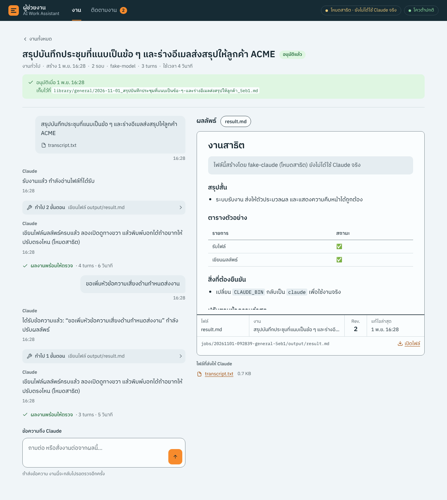
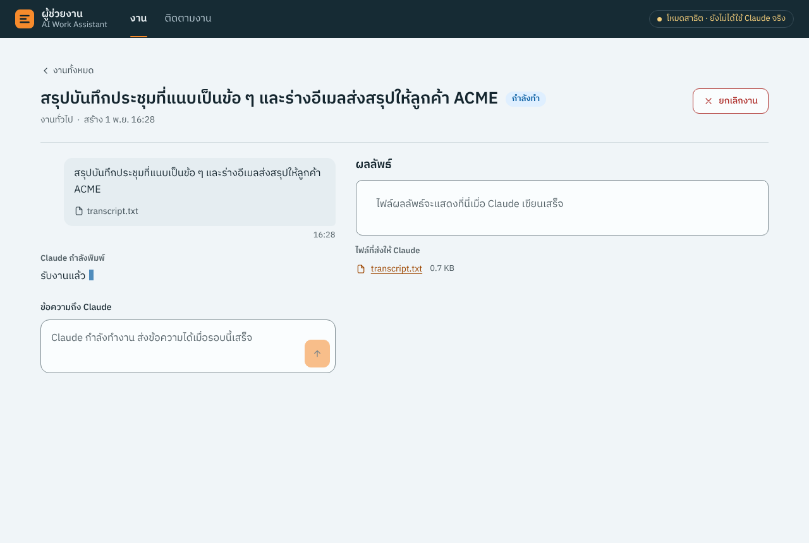

# AI Work Assistant — ผู้ช่วยงานส่วนตัวบน Synology NAS

ผู้ช่วยงาน AI สำหรับ 3 งานหลัก: **สรุปประชุมและติดตามงาน**, **งานขาย**, **ผู้ช่วยออกแบบวิศวกรรม**

- **การประมวลผล**: ทำโดย Claude บน cloud ผ่าน **Claude subscription ของคุณ** (ไม่ใช้ API key, ไม่คิดเงินตาม token)
- **NAS (DS925+)**: เก็บไฟล์ทั้งหมด และมี **dashboard** ให้สั่งงาน Claude ได้โดยตรง คุยต่อในงานเดิมได้เหมือนแชท
  และเห็นว่า Claude กำลังทำอะไรอยู่แบบสด ๆ



## ทำงานอย่างไร

```
 คุณ ─ เบราว์เซอร์ / มือถือ (ในออฟฟิศ หรือผ่าน VPN) ─ http://NAS:8080
                      │
 ┌────────────────────┴──── DS925+ · Container Manager ─────────────
 │  container: ai-work-assistant
 │    Dashboard + API      คิวงาน · ความคืบหน้าสด · ผลลัพธ์ · อนุมัติ/สั่งแก้
 │    Worker               หยิบงานจากคิว แล้วรัน `claude -p` ทีละงาน
 │    Inbox / ตั้งเวลา      ไฟล์ใหม่ใน inbox → สรุปประชุม · ติดตามงานทุกเช้า
 │    Claude Code CLI      ตัวจริงของ Anthropic ล็อกอินด้วย subscription ของคุณ
 │
 │  /volume1/ai-assistant/   data/ (งานทั้งหมด) · knowledge/ (อ่านอย่างเดียว) · claude-home/
 └────────────────────┬─────────────────────────────────────────────
                      │ HTTPS
              Claude (cloud) — อ่าน คิด และเขียนผลงาน
```

ลำดับของงาน 1 ชิ้น

1. **สร้างงาน** ได้ 3 ทาง: กรอกในหน้าเว็บ, วางไฟล์ลงโฟลเดอร์ `inbox/meeting` บน NAS, หรือให้ระบบสร้างเองตามเวลา
2. **Worker** เตรียมโฟลเดอร์งาน แล้วส่งคำสั่งให้ `claude -p --output-format stream-json`
3. **Claude** อ่าน `input/` กับคลังความรู้ แล้วเขียนผลลัพธ์ลง `output/` ทุกขั้นตอน (อ่านไฟล์ไหน ค้นอะไร เขียนอะไร) ขึ้น timeline บน dashboard ทันที
4. งานเข้าสถานะ **รอตรวจ** คุณกด **อนุมัติผลงาน** หรือพิมพ์ข้อความถึง Claude ในหน้างานนั้น (Claude ทำต่อจาก session เดิม จึงจำบริบทได้)
5. เมื่ออนุมัติ ผลงานถูกเก็บใน `library/` และ action item จากประชุมจะเข้ารายการ **ติดตามงาน**

## สั่งงาน Claude จากหน้าเว็บ

- **หน้าแรก** มีกล่องสั่งงานกล่องเดียว เลือกชนิดงาน พิมพ์สิ่งที่ต้องการ แนบไฟล์ (ลากไฟล์มาวางได้) แล้วกด **ส่งให้ Claude**
  หรือ Ctrl + Enter งานจะเข้าคิวและเปิดหน้างานให้ทันที
- **หน้างาน** แสดงเป็นบทสนทนา ข้อความของคุณ คำตอบของ Claude และขั้นตอนที่ Claude ทำ (อ่านไฟล์ไหน ค้นอะไร เขียนอะไร)
  ระหว่างที่ Claude กำลังตอบ จะเห็นข้อความพิมพ์ขึ้นมาสด ๆ
- **คุยต่อในงานเดิม** พิมพ์ในช่อง "ข้อความถึง Claude" เพื่อถามต่อ สั่งแก้ หรือสั่งงานต่อจากผลเดิม ระบบรัน `claude -p --resume`
  กับ session เดิม Claude จึงจำไฟล์และบทสนทนาก่อนหน้าได้ งานที่อนุมัติแล้วก็คุยต่อได้ (จะกลับไปรอตรวจอีกครั้ง)
- **เอกสารผลลัพธ์** แสดงทางขวาเหมือนแผ่นงาน มีกรอบรายการแบบ title block ของแบบวิศวกรรม (ไฟล์ งาน Rev. วันที่แก้ล่าสุด
  และที่เก็บบน NAS) ทุกครั้งที่ Claude แก้ตามข้อความของคุณ เลข Rev. จะเพิ่มขึ้น

ข้อจำกัดที่ควรรู้: แต่ละข้อความคือ Claude ทำงาน 1 รอบ ไม่ใช่แชทที่ตอบทันทีแบบ claude.ai ระหว่างที่ Claude กำลังทำรอบหนึ่ง
ส่งข้อความใหม่ไม่ได้ (ปุ่มยกเลิกงานใช้ได้เสมอ) และ Claude ทำได้เฉพาะในโฟลเดอร์งานกับคลังความรู้ ไม่มีการเข้าเว็บ

| หน้าแรก | ติดตามงาน | มือถือ |
|---|---|---|
|  |  |  |

| ระหว่างที่ Claude กำลังทำ | โหมดมืด (ตามการตั้งค่าเครื่อง) |
|---|---|
|  |  |

*ภาพจากโหมดสาธิต (`fake-claude`) ซึ่งจำลองการทำงานโดยไม่ได้เรียก Claude จริง*

## ชนิดงาน

| งาน | ใช้ข้อมูลจาก | ผลลัพธ์ |
|---|---|---|
| 📝 สรุปประชุม | transcript (.txt .vtt .srt .docx .pdf) | `summary.md`, `action_items.json` |
| ⏰ ติดตามงาน | action item ที่ยังเปิดอยู่ (สร้างอัตโนมัติ จ.–ศ. 08:00) | `follow-up.md` พร้อมร่างข้อความทวงงาน |
| 🤝 เตรียมพบลูกค้า | `knowledge/customers/<ชื่อ>/` และสรุปประชุมเก่าที่มีชื่อลูกค้า | `brief.md` |
| 💼 ร่างใบเสนอราคา | requirement และ price list ใน `knowledge/pricing/` | `proposal.md` (คำนวณยอดด้วย Python) |
| 📐 ถามงานวิศวกรรม | `knowledge/engineering/` | `answer.md` และสคริปต์ `calc_*.py` |
| ✨ งานทั่วไป | คำสั่งอิสระ และไฟล์แนบ | `result.md` |

คำสั่ง (prompt) ของแต่ละงานอยู่ใน [`app/prompts/`](app/prompts) ถ้าต้องการปรับโดยไม่ต้อง build ใหม่
ให้คัดลอกไฟล์ไปไว้ที่ `data/config/prompts/` บน NAS แล้วแก้ ระบบจะใช้ไฟล์นั้นแทน

## โครงสร้างโฟลเดอร์บน NAS

```
ai-assistant/
├── data/
│   ├── inbox/meeting/        ← วาง transcript ที่นี่ ระบบจะสร้างงานสรุปประชุมให้เอง
│   ├── jobs/<job-id>/        ← 1 งาน = 1 โฟลเดอร์: input/ context/ output/ job.json events.jsonl
│   ├── library/              ← ผลงานที่อนุมัติแล้ว แยกตามชนิดงาน
│   ├── tasks/action_items.json
│   └── config/prompts/       ← prompt ที่ปรับเอง (ถ้ามี)
├── knowledge/                ← คลังความรู้ Claude อ่านได้อย่างเดียว
│   ├── customers/<ชื่อลูกค้า>/
│   ├── pricing/              ← price list (แนะนำ .csv)
│   ├── engineering/          ← design guide, มาตรฐานที่บริษัทมีสิทธิ์ใช้, calc sheet เก่า
│   └── templates/
└── claude-home/              ← login และประวัติ session ของ Claude Code (ห้ามแชร์)
```

## เริ่มใช้งาน

ขั้นตอนละเอียดอยู่ใน **[docs/setup-ds925.md](docs/setup-ds925.md)** สรุปสั้น ๆ ได้ดังนี้

1. สร้างโฟลเดอร์ `ai-assistant/{data,knowledge,claude-home}` แล้วนำโค้ดนี้ไปไว้บน NAS
2. คัดลอก `.env.example` เป็น `.env` แล้วแก้ path และตั้ง `DASHBOARD_PASSWORD`
3. Container Manager → Project → Create → เลือกโฟลเดอร์โค้ด → Build และ Start
4. ล็อกอิน Claude ครั้งเดียว: `sudo docker exec -it ai-work-assistant claude auth login`
5. เปิด `http://<IP ของ NAS>:8080`

อยากลองระบบก่อนโดยไม่ใช้ Claude จริง ให้ตั้ง `CLAUDE_BIN=/opt/app/scripts/fake-claude` ใน `.env`
dashboard จะขึ้นป้าย "โหมดสาธิต"

## เรื่องที่ควรรู้เมื่อใช้ Claude subscription

- ระบบรัน **Claude Code CLI ของ Anthropic แบบไม่ดัดแปลง** และคุณล็อกอินด้วยบัญชีของตัวเองผ่านขั้นตอนของ Anthropic
  ตัวแอปไม่ขอ ไม่เก็บ และไม่ส่งต่อรหัสหรือ token ของ Claude
- **ใช้ส่วนตัวเท่านั้น** โควต้าของแพ็กเกจคิดจากการใช้งานปกติของคนคนเดียว อย่าเปิดให้เพื่อนร่วมงานส่งงานผ่านบัญชีของคุณ
  ถ้าจะใช้ทั้งทีม ให้แต่ละคนใช้ seat ของตัวเอง (Team/Enterprise) หรือเปลี่ยนไปใช้ API key
- งานทุกชิ้น**นับรวมในโควต้า subscription** (รอบ 5 ชั่วโมงและรายสัปดาห์) ระบบจึงทำทีละงานเป็นค่าตั้งต้น
  dashboard แสดงสถานะโควต้า และถ้าโควต้าเต็มระหว่างทำ งานจะรอแล้วเริ่มใหม่เองเมื่อโควต้ารีเซ็ต
- ระบบลบ `ANTHROPIC_API_KEY` ออกจาก environment ของ Claude Code เสมอ กันไม่ให้เผลอคิดเงินแบบ API
  และไม่ใช้โหมด `--bare` เพราะโหมดนั้นไม่อ่าน login ของ subscription
- token จาก `claude setup-token` มีอายุ 1 ปี ถ้าใช้วิธีนี้ให้ตั้งเตือนตัวเองไว้ต่ออายุ

## ความปลอดภัย

- Claude เขียนได้เฉพาะในโฟลเดอร์งานของตัวเอง ส่วน `knowledge/` ถูก mount แบบอ่านอย่างเดียว
- เครื่องมือที่อนุญาตมีแค่ Read, Write, Edit, Glob, Grep และ `python3` (เฉพาะงานวิศวกรรมกับใบเสนอราคา)
  ไม่เปิดให้เข้าเว็บ เพื่อลดโอกาสที่ข้อมูลบริษัทจะรั่วผ่าน prompt injection
- ตั้ง `DASHBOARD_PASSWORD` และเข้าใช้ผ่าน LAN หรือ VPN (Tailscale / Synology VPN Server) **อย่า forward port ออกอินเทอร์เน็ต**
- ทุกงานต้องผ่านการกดอนุมัติก่อนนำไปใช้ งานวิศวกรรมยังต้องให้วิศวกรผู้มีใบอนุญาตตรวจรับรอง
- ข้อมูลที่ส่งให้ Claude อยู่ภายใต้เงื่อนไขของแพ็กเกจที่คุณใช้ ตรวจให้สอดคล้องกับนโยบายบริษัท สัญญา NDA กับลูกค้า
  และ PDPA (การบันทึกเสียงประชุมต้องแจ้งผู้เข้าร่วม)

## หน้าตาและการออกแบบ

หน้าเว็บออกแบบตามกฎของ [Impeccable](https://github.com/pbakaus/impeccable) (design skill ของ Paul Bakaus, v4.8.0)
โดยอ่านกฎจากซอร์สของ skill แล้วนำมาใช้เอง ไม่ได้ติดตั้งหรือรัน engine ของมัน รายละเอียดของ brief อยู่ใน [`PRODUCT.md`](PRODUCT.md)

- หน้าจอแบบ **Operate** (ใช้ทำงาน): ปุ่มและการนำทางเป็นแบบมาตรฐาน หัวหน้าจอสีเทาอมฟ้าเข้ม และใช้สีส้มแบบเสื้อสะท้อนแสงหน้างาน
  เฉพาะปุ่มหลัก สิ่งที่เลือกอยู่ และตัวเลขสถานะ
- ฟอนต์เดียว **IBM Plex Sans Thai** เก็บไว้ในโปรเจกต์ (ใช้งานได้แม้ NAS ไม่ต่ออินเทอร์เน็ต, สัญญาอนุญาต SIL OFL ใน `app/static/fonts/OFL.txt`)
- สีทุกคู่ผ่าน WCAG AA ทั้งโหมดสว่างและมืด, ปุ่มบนมือถือสูงอย่างน้อย 44 px, รองรับการลดภาพเคลื่อนไหว
- ถ้าจะปรับหน้าตาต่อด้วย Impeccable ติดตั้งในโปรเจกต์ด้วย `npx impeccable install` หรือใน Claude Code
  `/plugin marketplace add pbakaus/impeccable` แล้วใช้คำสั่ง เช่น `/impeccable audit` หรือ `/impeccable polish`

## พัฒนาต่อและทดสอบ

```bash
python3 -m venv .venv && .venv/bin/pip install -r requirements-dev.txt
.venv/bin/python -m pytest

# เปิด dashboard บนเครื่องตัวเองด้วยตัวจำลอง
DATA_DIR=./data KNOWLEDGE_DIR=./knowledge CLAUDE_BIN=./scripts/fake-claude \
  .venv/bin/uvicorn app.main:create_app --factory --port 8080
```

| ไฟล์ | หน้าที่ |
|---|---|
| `app/runner.py` | สร้างคำสั่ง `claude -p` ส่งงาน อ่าน stream-json จัดการคิว ยกเลิก ลองใหม่ และรอโควต้า |
| `app/events.py` | แปลง event ของ Claude Code เป็นข้อความภาษาไทยบน timeline |
| `app/store.py`, `app/tasks.py` | เก็บงานและ action item เป็นไฟล์บน NAS |
| `app/watchers.py` | เฝ้าโฟลเดอร์ inbox และตั้งเวลางานติดตาม |
| `app/main.py`, `app/static/` | API และหน้า dashboard (HTML/CSS/JS ล้วน ไม่ต้อง build) |
| `PRODUCT.md` | brief การออกแบบ (ผู้ใช้ สถานการณ์ใช้งาน สี ฟอนต์ signature move) |
| `scripts/fake-claude` | ตัวจำลอง `claude` สำหรับทดสอบ |

## สิ่งที่จะทำต่อ

- [ ] ถอดเสียงประชุมภาษาไทยบน NAS (Whisper) เพื่อรับไฟล์เสียงได้โดยตรง
- [ ] export ผลลัพธ์เป็น .docx ตาม template บริษัท
- [ ] แนบไฟล์เพิ่มระหว่างคุยต่อในงานเดิม
- [ ] แจ้งเตือนผ่าน Synology Chat หรือ LINE Messaging API เมื่อมีงานรอตรวจ
- [ ] เครื่องมือคำนวณวิศวกรรมที่ทีมตรวจสอบแล้ว (MCP server) ให้ Claude เรียกใช้
- [ ] ค้นเอกสารใน knowledge แบบ semantic search
